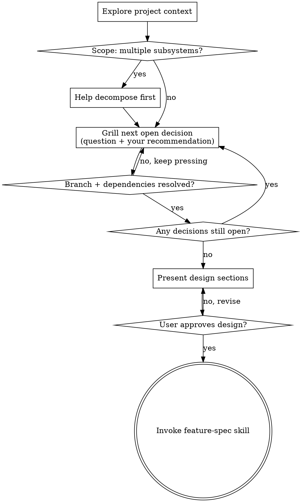

# Brainstorm: Grill Mode

This skill has the same destination as `brainstorm`: an approved design handed to feature-spec. It takes a harder road. You do not draw the idea out gently. You interrogate it. Walk down every branch of the decision tree and resolve the dependencies between decisions one at a time. Do not move on while a branch is open. The goal is that you and the user understand the plan fully, with no soft spots.

This skill is a sibling of `brainstorm`, not a replacement. Default `brainstorm` stays gentle. Invoke this skill only when the user wants a grill.

`grill-me` (`skills/core/grill-me`) is the variant that ends at decisions and a `brief.md`. It has no design step and no feature-spec chain. Use `grill-me` when the user wants decisions and not a spec.

<HARD-GATE>
Do NOT write any code, scaffold any project, or take any implementation action until you present a design and the user approves it. Grilling is interrogation, not implementation. This applies to EVERY project, whatever its apparent simplicity.
</HARD-GATE>

## What "grill properly" means

The questioning differs from default brainstorm. The outcome does not.

| Default brainstorm | Grill mode |
|---|---|
| Gentle clarifying questions | Relentless interrogation of every decision |
| Asks, then waits | Asks via AskUserQuestion. Your recommended answer is option 1, with the reasoning in its description |
| Moves on when the user answers | Moves on only after the branch and its dependencies have an answer |
| Accepts vague answers and refines later | Pushes back on a vague answer at once and pins down the testable version |
| Proposes 2-3 approaches near the end | Surfaces each fork when it appears and walks each branch to resolution |

**Every question carries your recommendation.** Never ask a bare question. Ask through the **AskUserQuestion** tool. The `question` states the decision. The `options` are the candidate answers. The first option is your recommendation. Its label ends in " (Recommended)" and its `description` gives the "because Y" reasoning. The user can pick it, choose another option, or use the built-in "Other" to override or argue. The user never has to fill a blank cold.

**Explore before you ask.** If the codebase can answer a question, read the codebase. Spend repo context freely. Ask the user only what the repo cannot tell you.

## Checklist

Create a task for each item and complete them in order:

1. **Explore project context.** Read files, docs, recent commits, and existing patterns. Answer from the repo everything it can answer.
2. **Scope check.** If the request is really several independent subsystems, say so before you grill. Help decompose it, then grill the first sub-project.
3. **Grill the decision tree.** Work round by round along the frontier. Give each question a recommended answer. Walk every branch and resolve the dependencies between decisions.
4. **Present the design.** Use sections scaled to complexity. Get approval after each section.
5. **Hand off to feature-spec.** Invoke the feature-spec skill to formalize the approved design.

## Process Flow

## The Grilling Protocol

**Map the decision tree first.** Before the first question, list the decisions the plan needs and how they depend on each other. You can do this silently or aloud. The **frontier** is the set of decisions whose prerequisites are all settled. Grill the frontier round by round. Each settled answer prunes the branches below it and pushes the frontier outward.

**Dispatch fact-finding in the background.** Some frontier questions depend on an environment fact. Examples: does the repo use X, or what does the schema look like. Spawn a subagent to find the fact and keep grilling the rest of the frontier. Do not block the round on a lookup that can run in the background.

**Ask every question through AskUserQuestion, with a recommendation.** Do not grill in plain prose. Each open decision becomes one AskUserQuestion question:

- `question`: the specific decision, framed concretely.
- `header`: a short tag for the decision (max 12 characters), such as "Storage", "Auth", or "Scope".
- `options`: the candidate answers, 2-4 of them. **Option 1 is your recommendation.** Its `label` ends in " (Recommended)". Its `description` gives the "because Y" reasoning, grounded in the repo, the constraints, or the goal. The other options are the live alternatives. Each `description` states the trade-off.
- `multiSelect: false`: a decision resolves to exactly one answer.

The user can accept your recommendation, pick an alternative, or use the automatic "Other" choice to override or argue. For an open-ended decision such as "what does 'works' mean here?", make option 1 the recommended testable definition and make the others plausible variants. Never leave a blank prose prompt. Sometimes the fork is between concrete artifacts. Examples are layout options, API shapes, or code snippets. Then put a short mockup of each in the option's `preview` field. The user then compares them side by side.

Ask the **current frontier as one round**. Every decision whose prerequisites are settled goes into the same AskUserQuestion call. The tool takes up to 4 questions. Split a larger frontier into consecutive calls, with the most constraining decisions first. Never batch a question with one of its own prerequisites. A later answer must not be able to invalidate an earlier question in the same round. Never ask without a recommendation.

**Resolve dependencies before you descend.** When an answer opens sub-decisions, walk those sub-branches to resolution before you return to the siblings. Track what is settled. Never re-litigate a closed branch. Never leave a branch dangling.

**Push back on vagueness.** "When it works", "something simple", and "the usual" are not answers. They are deferrals. Convert each one into a testable statement on the spot. For example: "'Works' means a user can do X and Y is true in the system. Correct?" Do not accept a hand-wave and move on.

**Probe for the gaps the user has not considered.** Check these areas:

- failure modes and edge cases
- behavior under concurrency
- empty, huge, or malformed input
- the rollback path
- the real success metric

If the plan has an unexamined assumption, name it. Make the user defend it or drop it.

**Explore the codebase instead of asking, whenever possible.** For "Which auth library?", read package.json. For "What is the existing error pattern?", search the codebase. Escalate to the user only the decisions the code cannot answer.

**Know when to stop.** Grilling ends when every branch of the decision tree has an answer. You must be able to state the design back with no open questions. Relentless does not mean infinite. It means thorough. When you and the user agree on the plan, stop grilling and present the design.

## Presenting the Design

Present the design as `brainstorm` does:

- Scale each section to its complexity. Use a few sentences if the section is simple. Use up to 200-300 words if it has nuance.
- Ask after each section whether it looks right.
- Cover architecture, components, data flow, error handling, and testing.
- You grilled the decisions, so the design should hold few surprises. It is the resolved decision tree written down.

**Design for isolation and clarity.** Break the system into small units with one clear purpose each. The units talk through well-defined interfaces. Each unit stays easy to understand and test on its own. For each unit, state what it does, how to use it, and what it depends on. A file that grows large does too much.

**In existing codebases,** explore the structure before you propose changes. Follow existing patterns. Fold in targeted improvements where existing problems affect the work. Do not propose unrelated refactoring.

## After the User Approves the Design

When the user approves the design, invoke the **feature-spec** skill to formalize it into a structured spec file. Pass a summary of every decision resolved during the grill. Then feature-spec pre-fills the spec and does not re-interview the user.

> "Design approved. Invoking feature-spec to formalize this into a structured spec."

Then invoke the feature-spec skill. brainstorm-grill ends here. feature-spec takes over the structured output. The spec lands in the `docs/specs/todo/` folder of the target repo.

## Key Principles

- **Grill the frontier round by round.** Batch the decisions whose prerequisites are all settled. Never batch a decision with its own prerequisite.
- **Every question carries your recommendation.** Ask via AskUserQuestion with the recommendation as option 1. Ask no bare questions.
- **Resolve dependencies in order.** Settle the constraining decisions first.
- **No vagueness survives.** Convert each hand-wave into a testable statement at once.
- **Explore the repo before you ask.** The code answers the free questions.
- **YAGNI ruthlessly.** Grill out each feature that does not earn its place.
- **Relentless, not infinite.** Stop when every branch has an answer, then present and converge.
